# SparkClean Pro
### GoHighLevel CRM & Marketing Automation

A practical GoHighLevel implementation for a home cleaning business, demonstrating CRM configuration, lead management, appointment scheduling, workflow automation, and customer follow up.

## Project Overview

SparkClean Pro is a demo home cleaning business project built in GoHighLevel. The system connects lead capture, contact management, sales pipelines, appointment booking, estimates, invoices, and post payment communication into a structured customer journey.

## Project Objectives

- Organize customer information using custom fields and contact tags.
- Manage leads and jobs through dedicated pipelines.
- Simplify consultation and site inspection scheduling.
- Automate lead nurturing and appointment communication.
- Track estimate follow ups and accepted estimates.
- Automate post payment communication and review requests.
- Demonstrate end to end testing of key customer journeys.

## Key Features

### CRM & Pipeline Management
- Custom contact fields for property and cleaning requirements.
- Contact tags for lead sources, follow ups, and customer status.
- New Leads and Active Jobs pipelines.
- Opportunity tracking and task management.

### Appointment Scheduling
- Free Consultation calendar.
- Site Inspection calendar.
- Appointment confirmations and reminder workflows.
- Missed appointment follow up.

### Marketing Automation
- New lead nurture workflow.
- Appointment confirmation and reminder workflow.
- Missed appointment workflow.
- Estimate follow up workflow.
- Estimate accepted workflow.
- Invoice paid and review request workflow.

### Lead Capture & Landing Page
- Customer facing landing page.
- Lead capture form with cleaning requirement fields.
- Consultation and site inspection booking buttons.

### Estimates, Invoices & Reputation
- Reusable estimate and invoice templates.
- Invoice paid automation.
- Thank you email and review request action.

### Reporting
- Dashboard widgets for opportunities and conversion.
- Appointment reporting.
- Lead source and task visibility.

## Customer Journey

1. A prospective customer submits the lead capture form.
2. Contact information is recorded in the CRM.
3. The new lead nurture workflow initiates follow up.
4. The lead is tracked through the New Leads pipeline.
5. Booking a consultation triggers appointment communication.
6. Estimates are sent and followed up.
7. Accepted estimates can move the opportunity to Won.
8. Recording an invoice as paid triggers post payment communication.
9. A review request action runs after the configured waiting period.

## Project Screenshots

### Landing Page

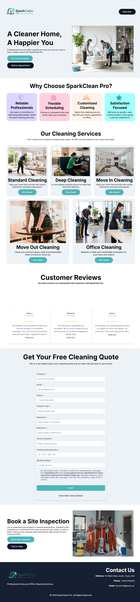

### Lead Capture Form

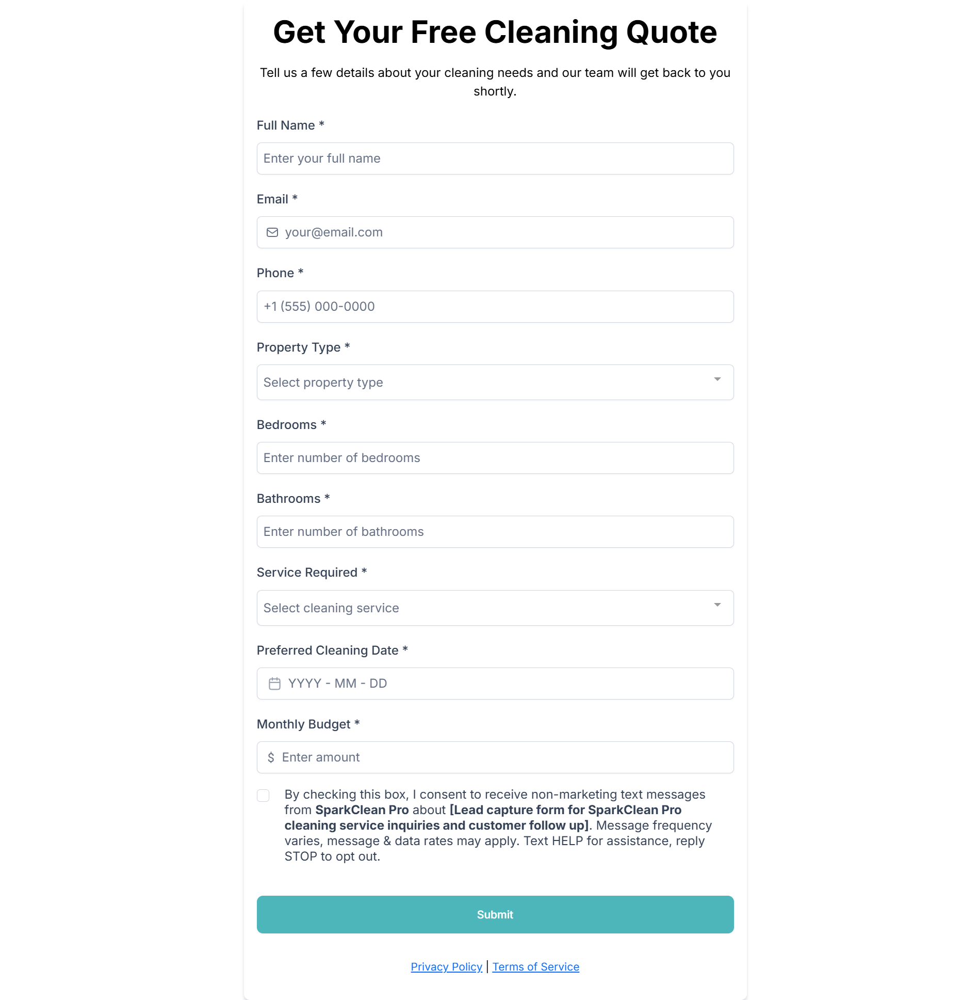

### Appointment Scheduling

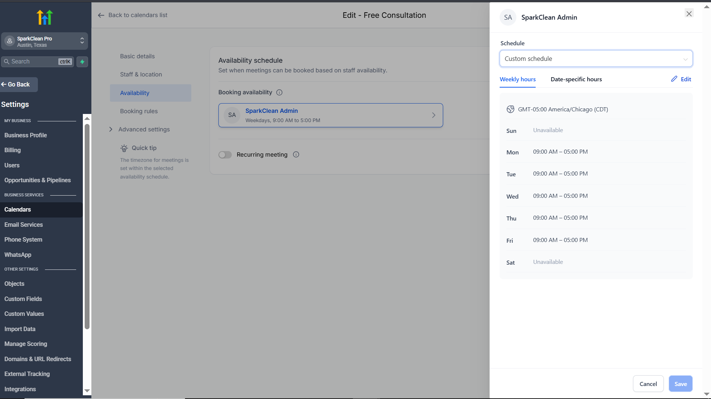

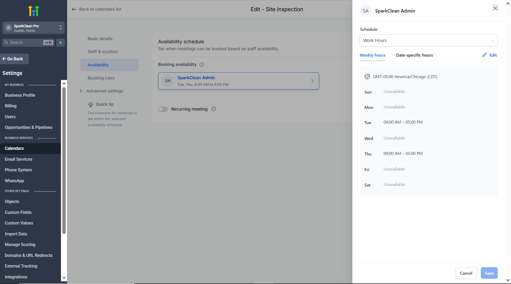

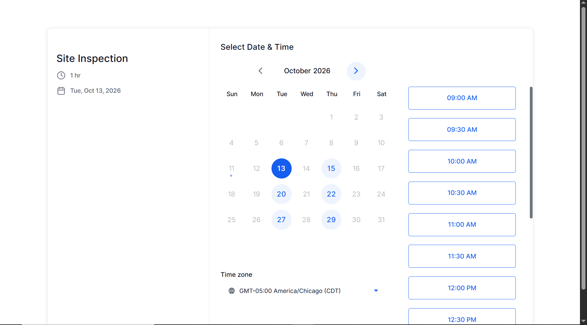

### CRM Pipelines

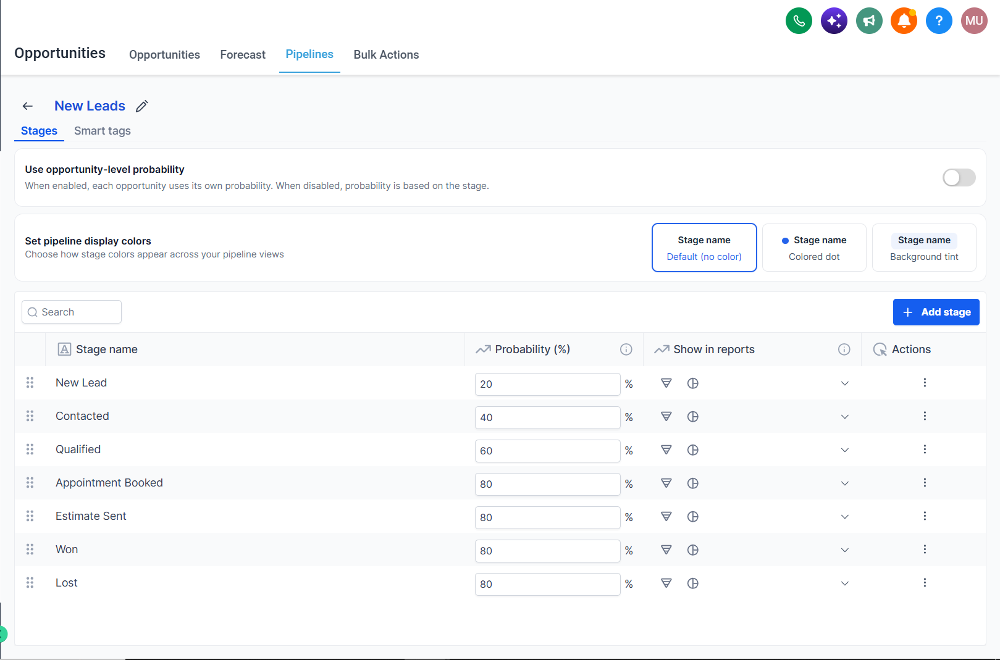

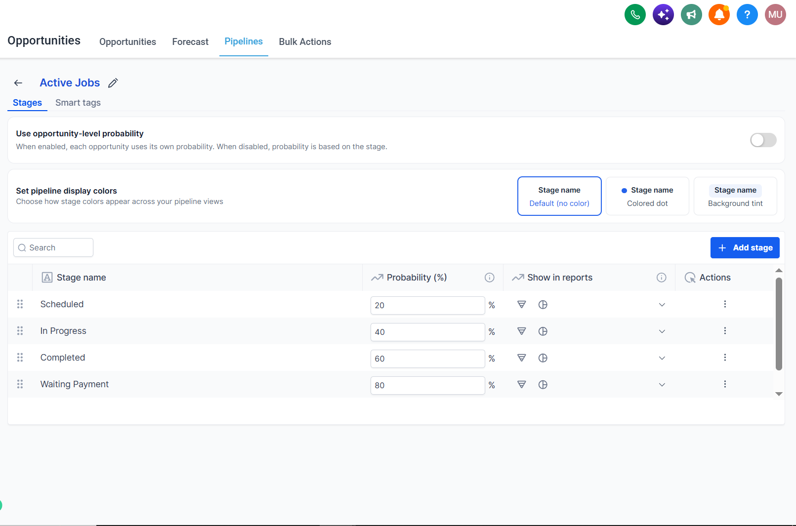

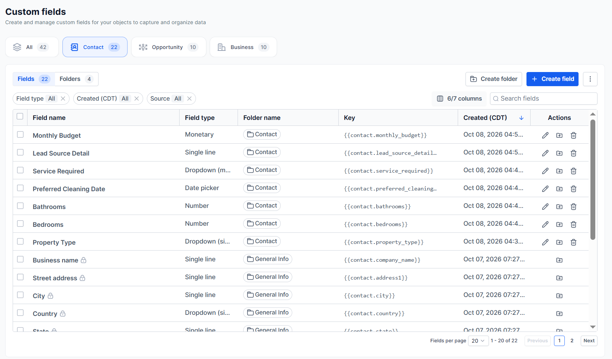

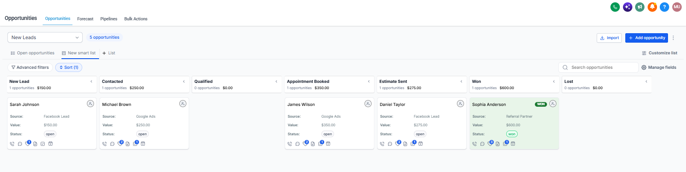

### Automation Workflows

Detailed workflow documentation:

- [New Lead Nurture](workflows/new-lead-nurture.md)
- [Appointment Workflow](workflows/appointment-workflow.md)
- [Missed Appointment Workflow](workflows/missed-appointment.md)
- [Estimate Follow Up](workflows/estimate-follow-up.md)
- [Estimate Accepted](workflows/estimate-accepted.md)
- [Invoice Paid & Review Request](workflows/invoice-paid-review-request.md)

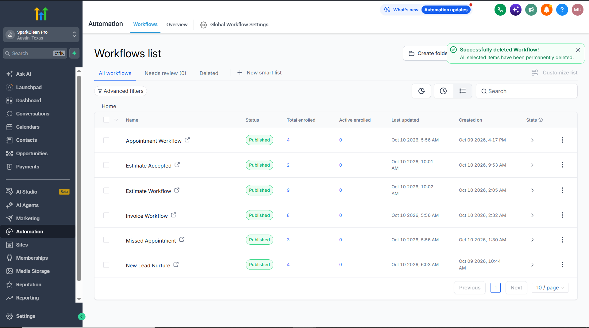

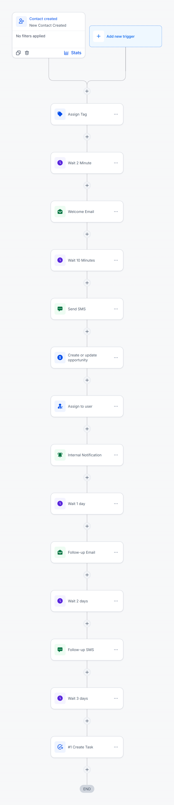

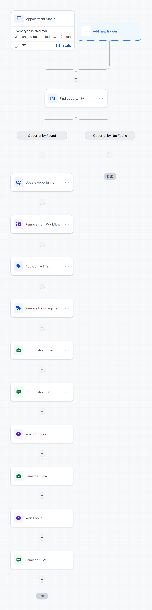

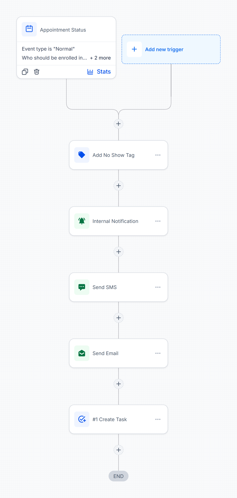

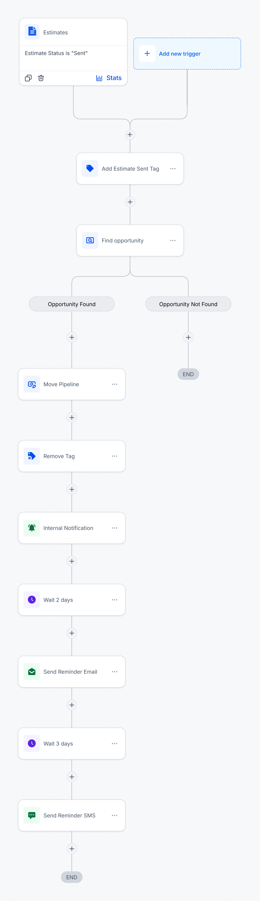

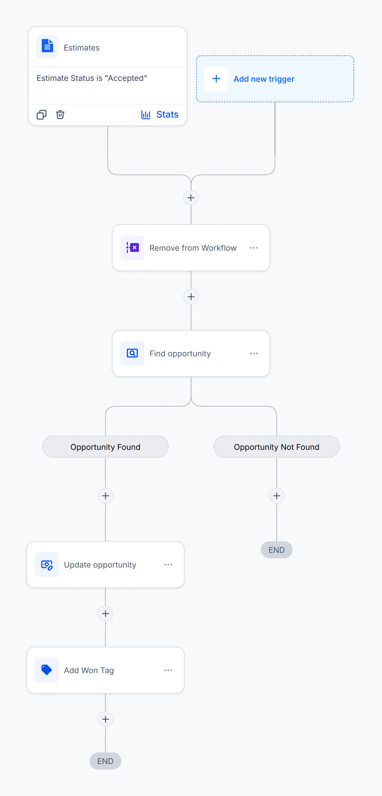

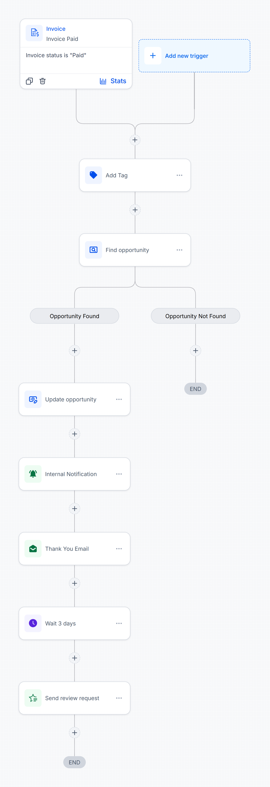

### Estimates & Invoices

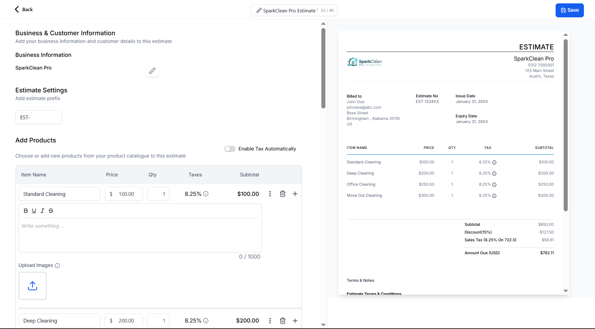

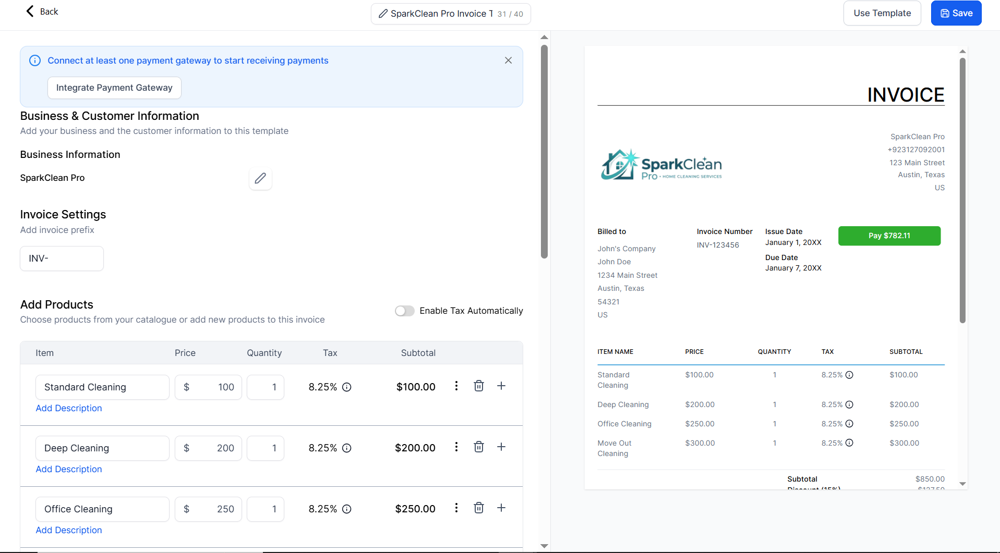

### Dashboard & Reporting

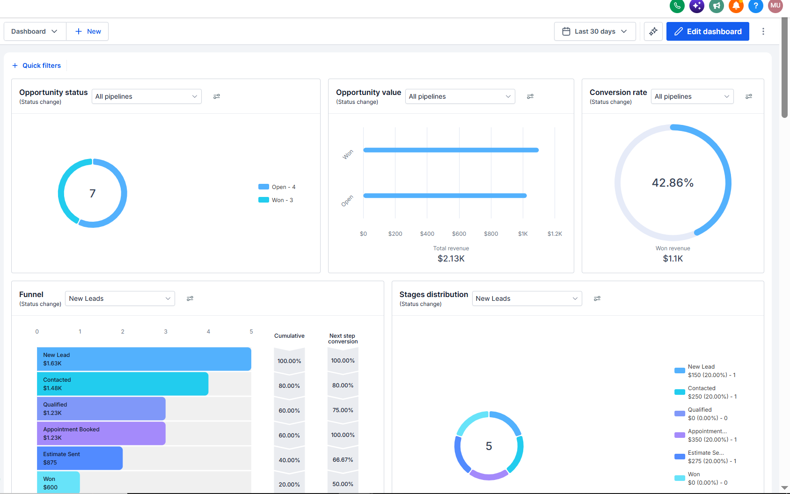

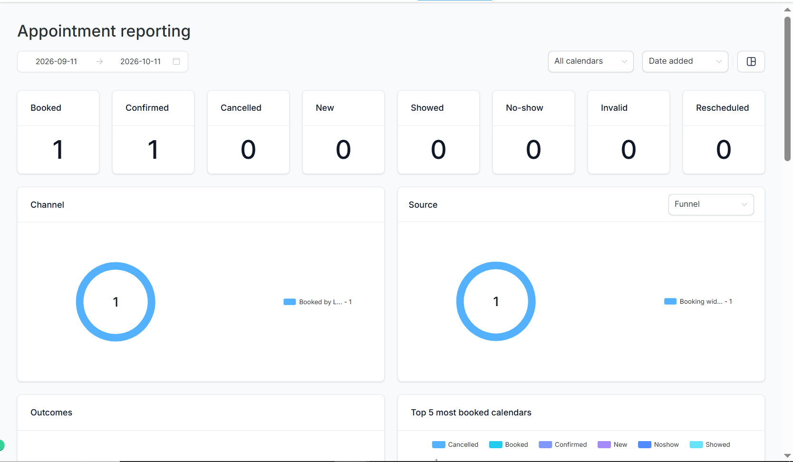

## Testing & Validation

The project was tested using demo contacts and test records.

Verified processes included:

- Lead form submission and contact creation.
- Contact tagging and opportunity creation.
- Welcome email delivery.
- Consultation booking and confirmation email.
- Missed appointment follow up email.
- Estimate delivery and acceptance handling.
- Opportunity update to Won after estimate acceptance.
- Manual invoice payment recording.
- Invoice Paid workflow execution and thank you email delivery.

## Limitations & Production Readiness

- The project uses demo contacts and test data.
- SMS delivery requires an appropriately configured messaging number.
- Review requests require a valid business review link.
- Public landing page access requires an appropriate domain and publishing setup.
- Invoice testing used a manually recorded cash payment; online payment gateway integration was not verified.
- Sample testimonials should not be presented as genuine customer reviews.

## Technology & Skills Demonstrated

- GoHighLevel CRM
- Contact Management
- Pipeline Configuration
- Workflow Automation
- Appointment Scheduling
- Forms & Landing Pages
- Estimates & Invoices
- Customer Follow Up
- Reputation Management
- Testing & Documentation

---

**Project:** SparkClean Pro  
**Platform:** GoHighLevel  
**Type:** Practical CRM & Marketing Automation Project
